<div align="center">

# 🎙️ Whisper Transcription Manager

**Your own transcription server for a whole library of recordings.**
It transcribes everything, tells the speakers apart, recognises the same
people across all your recordings, and lets you find any moment again —
by what was said, what it meant, or what you saw and heard.
Running on your hardware, in your browser.

[](LICENSE)
[](docs/GUIDE.md#prerequisites)
[](CHANGELOG.md)
[](docs/GUIDE.md#hardware-support)
[](https://github.com/lexusmexus961/whisper-transcription-manager/actions/workflows/tests.yml)

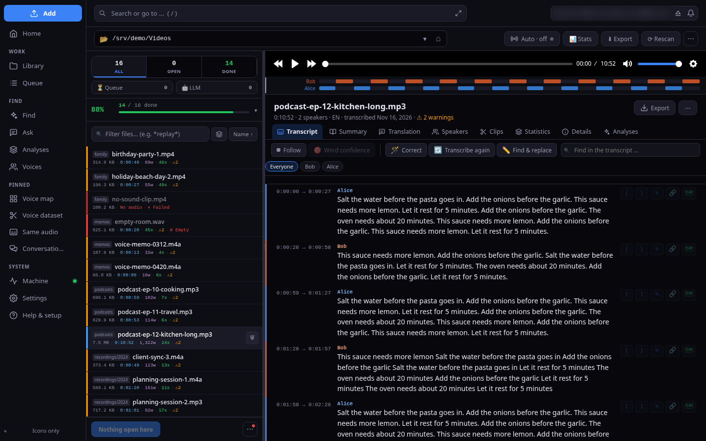

[**Quick start**](#-quick-start) · [**Voices**](#%EF%B8%8F-recognising-voices-across-your-whole-library) · [**Find anything**](#-find-anything) · [**Subtitles**](#-subtitles-with-word-level-timing) · [**Voice datasets**](#%EF%B8%8F-voice-datasets-built-for-you) · [**One real library**](#-one-real-library) · [**Performance**](#-performance) · [**Features**](#-everything-it-does) · [**Requirements**](#%EF%B8%8F-what-you-need) · [**Screenshots**](#-screenshots) · [**The full guide**](docs/GUIDE.md)

</div>

---

This started with a problem many people have and few tools solve: years of
recordings — videos, streams, podcasts, calls, voice messages — piled up on a
NAS, and no way to find anything in them. Transcribing one file is easy. Making
*two hundred thousand* of them searchable, knowing who speaks in each, and
finding that one moment you half remember — that's what this app is for.

## ✨ Highlights

- 📚 **It's built for libraries, not single files.** Point it at a folder or a
  whole NAS and walk away. The queue runs on the server, keeps going with the
  browser closed, and can pick up new files on its own. It runs every day on a
  library of [over 200,000 recordings](#-one-real-library).
- 🗣️ **It knows who is talking — in every recording.** This is the big one.
  Most tools give you *SPEAKER_00* and *SPEAKER_01* inside one file and forget
  them at the next. This one recognises the same person again across your whole
  library: you name a voice once, and after a few clicks it knows them everywhere.
  [How that works ↓](#%EF%B8%8F-recognising-voices-across-your-whole-library)
- 🔎 **You find things the way you remember them.** "Someone says the train
  leaves early", "a dog barking at night", "the video where Alice is in the
  garden" — Find searches by words, by meaning and by what was **seen and
  heard** (Google's EmbeddingGemma 2 puts pictures, video, sound and text into
  one space), and a language model double-checks every hit.
  [How ↓](#-find-anything)
- 🤖 **Bring the language model you like.** Summaries, translations, a chat that
  searches your library and quotes its sources, analyses over hundreds of
  recordings at once — with a local model (llama.cpp, Ollama) or any
  OpenAI-compatible service.
- 🔒 **It's yours.** Everything runs and stays on your machine. Nothing leaves it
  unless you pick a remote language model yourself.

## 📈 One real library

No demo numbers — this is the library the app runs on every day (November 2026):

| | |
|---|---|
| 📁 **Recordings** | **214,432** files · **31,500 hours** · **16.2 TB** on a NAS |
| 📝 **Transcribed** | **182,713** transcripts · **24,700 hours** · **104.5 million words** in **10.9 million** segments · 7 languages |
| 🗣️ **Voices** | **928,459** voice vectors from **88,790** recordings — **205,730** speaker centroids, **6,900 hours** of speech |
| 👤 **Named** | **185,772** voices of 33 people (**1,475 hours** of speech) from just **811 decisions** — 90 % of them named by spreading, not by hand |
| 🖼️ **Seen & heard** | **3.0 million** moments of **39,495** recordings in **8.1 million** vectors (EmbeddingGemma 2) — and growing |
| 🗄️ **Database** | 6.0 GB library index with full-text search (SQLite FTS5) + 1.7 GB of voices |

## ⚡ Performance

All measured on that library, on a 12 GB consumer card, with the full pipeline
(large-v3, vocal isolation, diarization, voice vectors) — **963 recordings of
about an hour each**:

<table>
<tr><td align="center"><h3>3 min 48 s</h3>for one hour of audio<br><sub>median · middle half 3:07–4:00</sub></td>
<td align="center"><h3>15.8×</h3>real time<br><sub>one file, everything included</sub></td>
<td align="center"><h3>1,000+ hours</h3>of audio a day<br><sub>three files at once, best days</sub></td></tr>
</table>

What makes it fast:

- 🔇 **Silence gets cut out before diarization.** Long quiet stretches never
  reach the speaker models; their times are mapped back afterwards (and a cut
  that doesn't add up is thrown away, never used).
- 🎚️ **Vocal isolation only where it helps.** A pre-filter skips clean speech;
  where it does run, it works in fixed chunks, so memory stays flat.
- 📼 **Each file is read once.** The audio track is copied and decoded in a
  single pass — that matters on a slow NAS.
- 🚦 **Three files at once on a 12 GB card.** A GPU gate lets the steps of
  different files share the card without running out of memory. Smaller cards
  take one file at a time.
- 🧠 **Models stay loaded** between files (smaller cards load them per step so
  everything fits).

<details>
<summary><b>Where the time goes</b></summary>

Median seconds per hour of audio, same 963 recordings. Some steps overlap, so
they add up to more than the total:

| Step | per hour of audio |
|---|---|
| Vocal isolation (MelBand Roformer) | ~3 min |
| Transcription (WhisperX large-v3) | ~45 s |
| Diarization (pyannote) | ~45 s |
| Word alignment | ~40 s |
| Reading the file, voice vectors | ~6 s each |

Without vocal isolation and diarization it's many times faster. Numbers for a
4 GB card, an 8 GB card and no GPU at all are under [What you need](#%EF%B8%8F-what-you-need).

</details>

## 🗣️ Recognising voices across your whole library

Telling speakers apart *inside* one recording is basically solved — pyannote
does it well. Knowing that *SPEAKER_01* in a podcast from March is the same
person as *SPEAKER_00* in a phone call from June is a different story. The
labels of one file mean nothing in the next, microphones and rooms and phone
lines change how a voice sounds, and the obvious approach falls apart the
moment your library gets big. This is the part of the app that took the most
work — and the one I'm proudest of.

<details>
<summary><b>Why it's hard, how it works, and the numbers</b></summary>

**Why the obvious approach fails.** "Connect every pair of voices that sound
alike enough" sounds reasonable. In practice the groups grow into chains: A
sounds like B, B like C, … and two hundred steps later the chain has swallowed
half the library, although its two ends have nothing in common. Raising the
threshold doesn't save you — long before the chains break, one person's own
recordings fall apart into dozens of pieces. On a real collection, *windows +
threshold* put **about half of all voices into a single group**.

**What it does instead** — three steps, borrowed from research on linking
speakers across recordings (radio archives, VoxSRC systems) and measured:

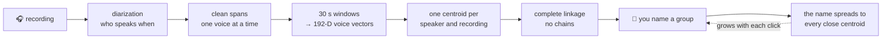

1. **Clean voice first, then vectors.** Only the stretches where exactly one
   person speaks — from vocal-isolated sound, so music doesn't colour the voice —
   are cut into 30-second windows, and each becomes a 192-dimensional voice
   vector (ReDimNet). All of them, not a sample: a quiet speaker in a
   seven-hour recording would slip through three random picks.
2. **Group without chains.** The windows of one speaker in one recording become
   one centroid (pyannote already did that grouping, so it's kept). Centroids
   are grouped by **complete linkage**: two groups only merge if *every* pair
   across them is close. Chains simply can't form — the largest group drops
   **from about half of everything to under 2 %**, and checked against several
   hundred hand-made assignments, **purity is above 99 %**. Two different
   people practically never end up together.
3. **You name, it spreads.** Pure groups are cautious, so one person is still
   spread over several groups. You name one; the name's centroid — the average
   of all voices with that name, growing with every click — pulls in every
   centroid close enough. With 10 % of a library named, about 80 % gets a name,
   and 98 % of those are right.

**How much work it is for you:**

| Clicks in the guided assignment | Share of the recurring speaking time named |
|---|---|
| ~15 | 50 % |
| ~100 | 80 % |
| ~300 | 95 % |

On the library above, **811 decisions** named **185,772 voices** — 17,644 in
the guided assignment, **168,124 by spreading**. The neighbourhood search behind
the voice map gets through 300,000 voice vectors in under five seconds on a
consumer GPU, in stripes, because the full similarity matrix alone would be
360 GB.

The guided assignment always asks about the group that would name the most open
speech first, plays you its samples and shows who it sounds like. Voices heard in
only one recording are left out on purpose — about a fifth of all speaking time
belongs to people who never come back. Every decision goes into a history you
can undo.

**To be honest:** it's the hardest part of the app, and it isn't magic. It needs
voice vectors — on by default from a 6 GB card; on smaller cards and without a
GPU you can switch them on, but it's slow. Very short turns, whispering, heavy
overlap and phone-quality audio give weaker vectors. And the threshold is
measured on real recordings, not promised for every voice. All the details are
in [the guide](docs/GUIDE.md#features).

</details>

## 🔎 Find anything

You rarely remember the exact words. You remember *a moment*: someone laughing
about the oven, a crowd at night, a song in the background, roughly who was
there and what the file was called. **Find** takes exactly that — one sentence
in your own words — and runs every search at once.

<details>
<summary><b>The searches, the judge, and EmbeddingGemma 2</b></summary>

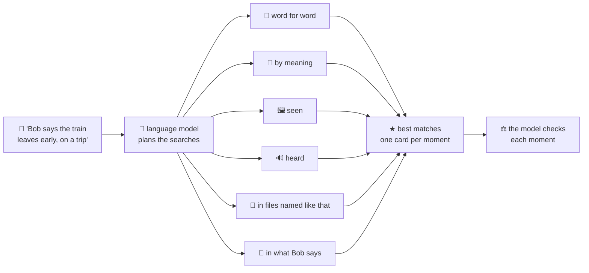

- **Everything in parallel, each in its own tile** — word for word (FTS5,
  ranked), by meaning (semantic search over the transcripts), what was **seen**
  and **heard**, and all of it again *inside* the files whose name you remember
  and *in what the named person says*. That last one is where the voice
  recognition really pays off.
- **Best matches** pulls it together per moment: each recording once, its other
  moments behind *+n more*, its copies (the same video as .mp4, .mkv and a
  backup) folded in — found by what the files contain, not by their names.
- **A judge that knows the facts.** The language model reads each candidate
  together with what the program knows for sure — who speaks, when, which file —
  and rates how well it fits; a moment that fails something you asked for can't
  rank high. Every hit plays its 10 seconds right there.

**Seen and heard, with EmbeddingGemma 2.** Google's
[EmbeddingGemma 2](https://ai.google.dev/gemma/docs/embeddinggemma/model_card_2)
(740 M parameters, Apache 2.0) puts **stills, short clips, clips with their
sound, sound windows and spoken text into one vector space**. That's the fun
part: anything can find anything. A sentence finds a picture, a picture finds a
sound, a sound you upload finds where it happens. "Police at night", "rock
music", "applause", or 🔁 *Similar* on a hit — no tags, no training, all on your
own machine. On the library above it already covers 3 million moments.

Find is also a tool for AI assistants (`find_moments` over MCP), so Ask can use
it mid-conversation.

</details>

## 🎬 Subtitles with word-level timing

Whisper on its own gives you long segments that end wherever the model happened
to pause — fine for reading, rough as subtitles. With **word-level timestamps**
(WhisperX's alignment, with a model per language) every single word gets its
own start and end, and the app builds the subtitle cues from those words itself:
it cuts at word boundaries, at pauses and at punctuation, within a duration and
a length you set. In languages without spaces, like Japanese and Chinese, it
counts characters instead of words.

<details>
<summary><b>All the settings</b></summary>

**When a cue ends** (Settings → Subtitles, used when a recording is transcribed):

| | Most languages | Japanese · Chinese |
|---|---|---|
| Longest cue | 3.5 s | 3.0 s (spoken Japanese is dense — 1 s gives very short, fluid cues) |
| Most per cue | 8 words | **15 characters** (the Netflix guideline: about 4 characters a second) |
| A pause that starts a new cue | 0.3 s | 0.15 s |
| *Only at natural boundaries* | the limits never cut a sentence — they make pauses and punctuation more eager instead | the same |

Because every word has its own timing, the transcript can also colour each word
by how sure Whisper was, and clips and the sentences of a voice dataset start
and end where the words do. Between Japanese or Chinese
characters no stray spaces are left behind (not even before a 。).

**How a cue looks** (the export's subtitle rules, saved per preset): characters
per line (10–120, default 42), lines per cue (1–4, default 2), the longest time
on screen (1–30 s, default 7) — a longer line gets split and its time shared by
its characters. Lines without spaces are broken by characters, and no line
starts with 、 。 」 or a small kana. Speaker names in front if you want them.

**Where they go:** SRT or WebVTT; the transcript, the **translation** or both as
subtitles; burned into a video export or next to it; a ZIP for a whole folder;
the preset *YouTube subtitles*; and if you switch it on, an `.srt` lands next to
every video right after it's transcribed — Plex and Jellyfin pick it up.

</details>

## 🎙️ Voice datasets, built for you

Once a voice has a name, the app can hand you **that person's voice as a
ready-to-use training dataset** — out of the hours of material you already have,
cut into clean sentences, without you listening through any of it:

- **Only clean solo speech** — sentences where that one voice speaks alone (the
  stored speech spans; overlap left out), each with its transcript.
- **Filters that matter for training** — how sure Whisper was of the sentence
  (75 % by default), length, speaking rate, date, folder, text, and only the
  conversations you pick (say, *Alice's voice from the hours she talks with Bob
  in long sentences*).
- **A preview you can fix** — every clip with its certainty, each word coloured
  by how sure its timing is and lit up while it plays; a clip editor with ±2.5 s
  of waveform, *cut at pauses*, text correction, keep or drop with one key.
- **Written the way trainers expect it** — one WAV per clip, `metadata.csv` in
  the **LJSpeech** layout and `metadata.jsonl` with certainty and edits, as a
  download or unpacked straight into a folder on the server where your TTS
  trainer picks it up. Or one audio file with subtitles, or every whole
  recording the person speaks in.

Please only use someone's voice with their consent — a dataset like this can
train a model that sounds like them.

## 🚀 Everything it does

| | |
|---|---|
| 🎧 **Transcription** | WhisperX large-v3 or turbo · word-level timestamps and [subtitle cues cut at the words](#-subtitles-with-word-level-timing) · the language detected per recording (or fixed) · vocal isolation (MelBand Roformer) against music and noise · silence skipped before diarization · a check of the final sentences · hallucination filters · every transcript records how it was made |
| ✍️ **Working on a transcript** | Edit segments · find & replace · each word coloured by how sure Whisper was · proofreading by the language model, with undo · re-transcribe, or redo only the voices |
| 👥 **Speakers & voices** | Diarization (pyannote) · the same voice recognised across recordings · a **voice map** of every voice, grouped by how alike they sound · guided naming that asks about the biggest open group first · names that spread · *Listen through* every voice of a person · a full history with undo and redo · **voice datasets** |
| 🔎 **Search** | **Find** — one sentence, every search at once · full-text (SQLite FTS5, ranked) · semantic search by meaning · **Images & sounds** — by what was seen or heard (EmbeddingGemma 2), also by a picture or a sound of your own · **Same audio** — every recording that contains a snippet, to the second · **Deep search** through everything with a reranker · filters by file, speaker, person, date, duration, words and speed |
| 🧾 **Duplicates & audio analysis** | Fingerprints, waveform and loudness of every recording · copies, and recordings contained in others, found by their sound rather than their names |
| 💬 **AI on top** | Summaries with templates · translations as a second track of the transcript · **Ask**: a chat that searches the library itself and quotes playable passages · **Analyses**: one task over a folder, a selection or a search — summarize, compare, find every place where … · **Best moments** for clips · local or remote models, one per task |
| 📊 **Conversations** | Who talks with whom, how long, how fast, how often the turn changes — per recording, per person, compared with the rest of the library · find the stretches where certain people talk together |
| ✂️ **Clips & export** | A clip editor with several cuts (one clip or one each, 16:9, 9:16 or square, with subtitles, pauses removed) · export as TXT, SRT, VTT, Markdown, CSV, JSON, DOCX and PDF, one file or a whole folder · audio and video re-encoded smaller · the original file |
| 📥 **Getting media in** | Drag and drop · any folder or NAS share · watch folders, checked every 15 minutes · links and playlists via yt-dlp · a **browser extension** for Chrome, Edge and Brave: click a YouTube video, get it transcribed and summarized |
| 📋 **Queue** | Runs on the server with the browser closed · several files at once on big cards · edit in bulk, add from the library or a folder · pause, cancel, retry what failed · AI jobs in a queue of their own |
| 🧩 **Integrations** | An **MCP server** with 30+ tools so AI assistants (Claude and others) can search, read, listen to clips and — if you allow it — work with the library · an OpenAPI server for Open WebUI · an HTTP API |
| ⚙️ **Operations** | A setup guide and a system check · live updates in every open tab · automatic backups of the database and the voices · an optional login with a brake against password guessing · 18 searchable settings pages · runs as a service, in Docker, or with `./start.sh` |

## 🖥️ What you need

| | |
|---|---|
| **System** | Linux, natively or in Docker. Windows through WSL2 or Docker Desktop (not tested on real hardware yet) |
| **GPU** | An NVIDIA card, GTX 9xx or newer — the setup picks the matching PyTorch build. **No GPU works too**, just many times slower |
| **VRAM** | 4 GB gets you started; 8 GB runs the full pipeline; 12 GB and up runs three files at once (table below) |
| **RAM** | 16 GB recommended — after a job the server holds 2–3 GB (measured with the 4 GB-card and CPU profiles) |
| **Disk** | About 20 GB for a native NVIDIA install (3 GB without a GPU), about 40 GB free for the first Docker build; the models add 2–4 GB |
| **Software** | git, curl, FFmpeg, a C compiler — `setup.sh` brings Python 3.11–3.13 and everything else itself |
| **Speaker diarization** | A free Hugging Face token (takes a minute, [here's how](docs/GUIDE.md#speaker-diarization-the-hugging-face-token)) |
| **Images & sounds** *(optional)* | One click in Settings installs it: its own environment (several GB) and the model (1.5 GB). Indexing a big archive takes days to weeks of GPU time; searching runs on the CPU |
| **Language model** *(optional)* | For summaries, translations, Ask, Find and Analyses: llama.cpp (the setup can install it), Ollama, or any OpenAI-compatible endpoint |

**What your card gets** — the app picks this itself at start; anything you set wins:

| Card | Whisper model | Vocal isolation | Voice vectors | Files at once |
|------|---------------|-----------------|---------------|---------------|
| No GPU | turbo | — | — | 1 |
| up to 4 GB | turbo | — | — | 1 |
| 6 GB | turbo | — | ✅ | 1 |
| 8–11 GB | large-v3 | ✅ | ✅ | 1 |
| 12 GB and more | large-v3 | ✅ | ✅ | 3 |

**Measured** on fresh installs — an 11-minute recording, two speakers, diarization, first run including the model downloads:

| Machine | Time | Peak VRAM |
|---------|------|-----------|
| 4 GB laptop card (Ampere) | 2 min 42 s | 2.3 GB |
| 8 GB card (Turing), full pipeline | 2 min 31 s | 5.5 GB |
| No GPU (22 threads) | 12 min 39 s | — |

## ⚡ Quick start

```bash
git clone https://github.com/lexusmexus961/whisper-transcription-manager.git
cd whisper-transcription-manager
./setup.sh          # detects your GPU, installs everything, asks for your library root and the HF token
./start.sh          # then open http://localhost:9860
```

Pick your library in the app (the path field at the top) and the setup guide
takes you through the rest. Prefer **Docker**? (Without an NVIDIA card, see
[the two lines in `.env`](docs/GUIDE.md#docker).)

```bash
cp .env.example .env && mkdir -p config    # in .env: MEDIA_DIR, HF_TOKEN
docker compose up -d --build
```

Everything else — every setup option, the local language model, Windows, the
settings, the network and the login — is in **[the guide](docs/GUIDE.md)**.

## 📸 Screenshots

Taken on a demo library of made-up recordings (computer voices, invented text).
Click a picture to see it full size.

<table>
<tr><td width="50%">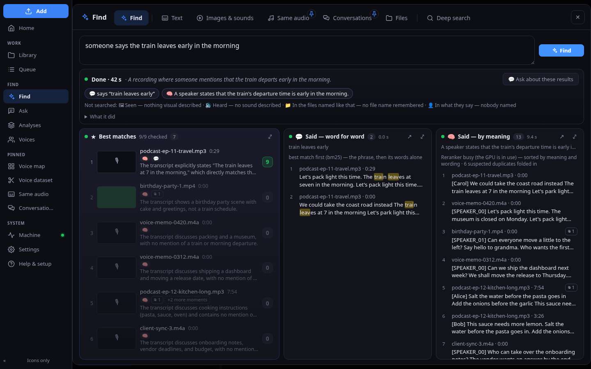<br><sub><b>Find</b> — describe a moment in your own words; matches by word and by meaning, checked by the language model</sub></td><td width="50%">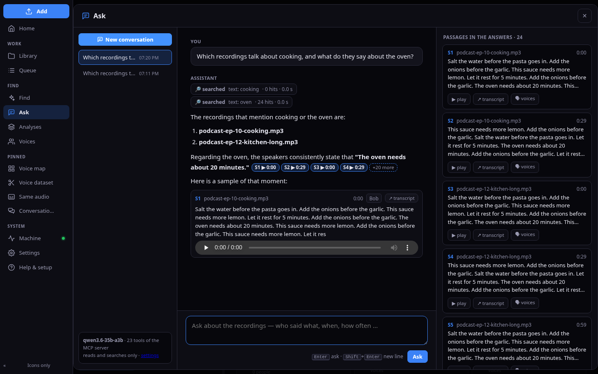<br><sub><b>Ask</b> — a chat that searches the library itself and quotes the passages</sub></td></tr>
<tr><td width="50%">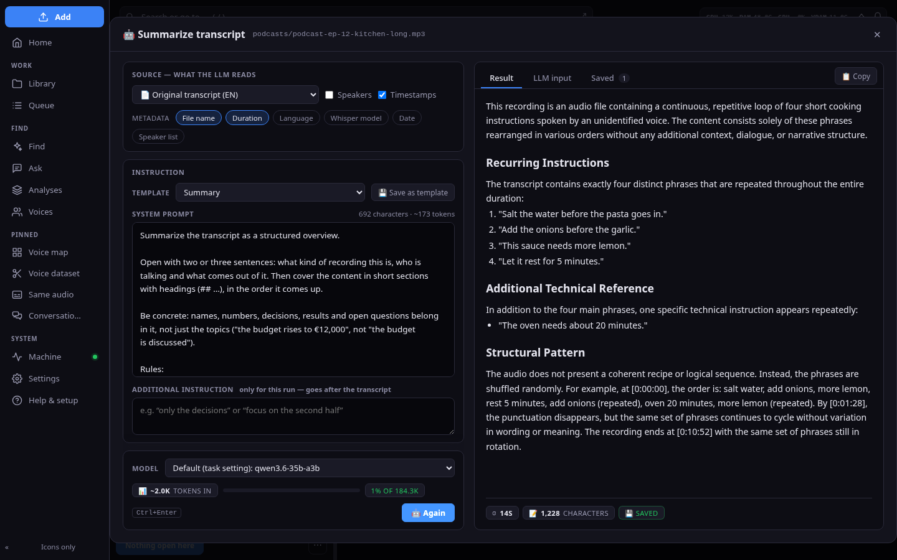<br><sub><b>Summaries</b> — with the instruction and the text the model read</sub></td><td width="50%">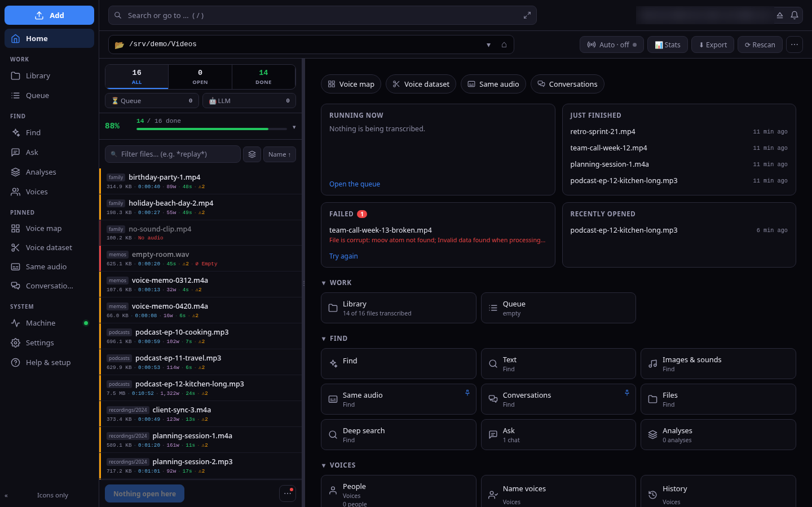<br><sub><b>Home</b> — what's running, what just finished, what failed, and every place</sub></td></tr>
<tr><td width="50%">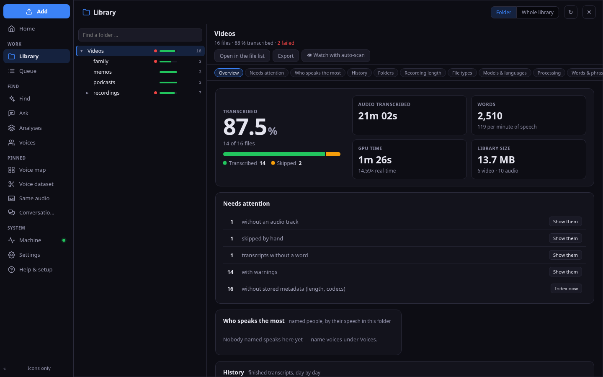<br><sub><b>Library</b> — every folder in numbers, and what needs attention</sub></td><td width="50%">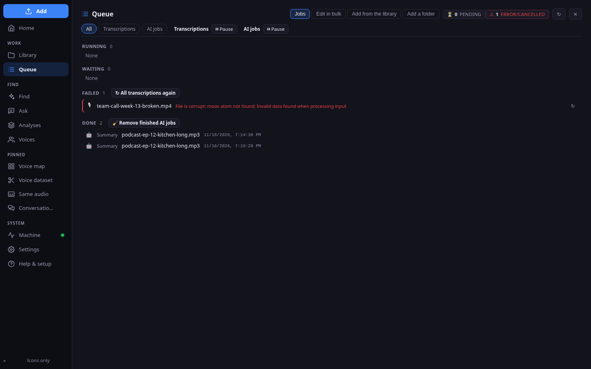<br><sub><b>Queue</b> — transcriptions and AI jobs: running, waiting, done, failed</sub></td></tr>
<tr><td width="50%">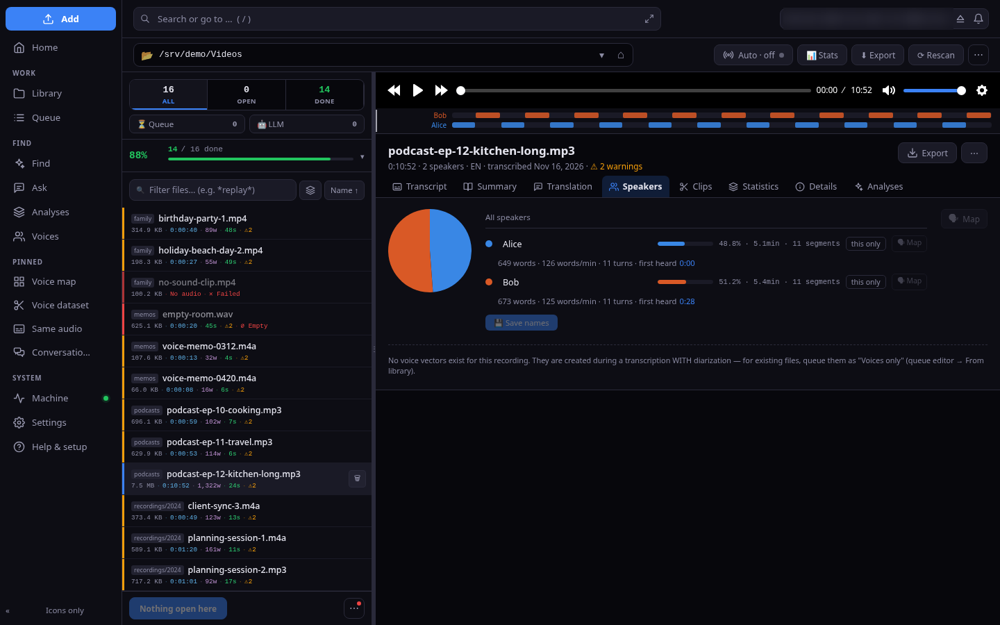<br><sub><b>Speakers</b> — who spoke how long and how fast</sub></td><td width="50%">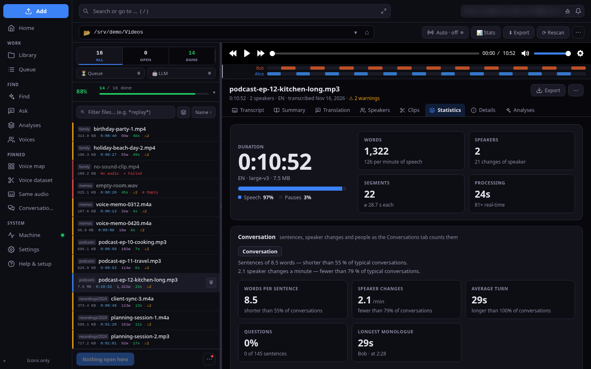<br><sub><b>Statistics</b> — speech, turns, and how the conversation compares</sub></td></tr>
<tr><td width="50%">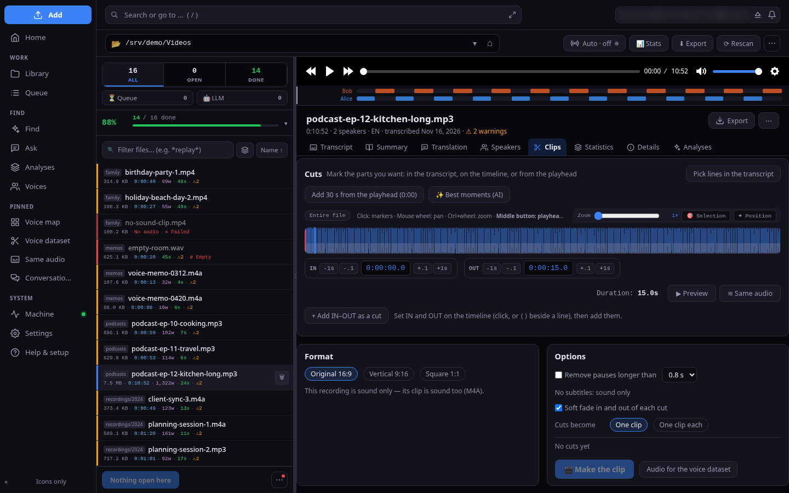<br><sub><b>Clips</b> — cut parts of a recording into a new file</sub></td><td width="50%">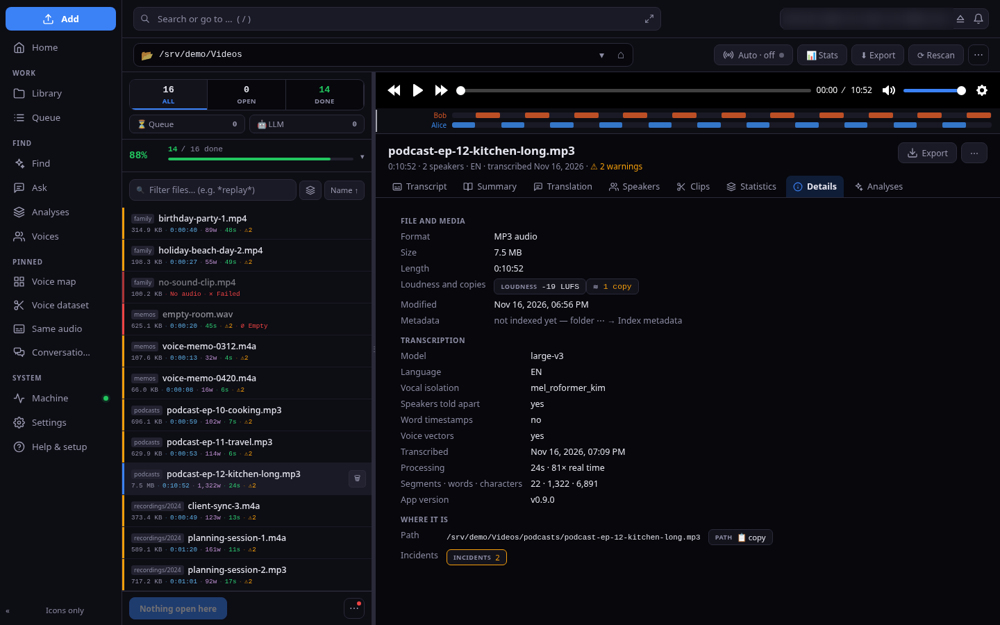<br><sub><b>Details</b> — models, steps and where the files are</sub></td></tr>
<tr><td width="50%">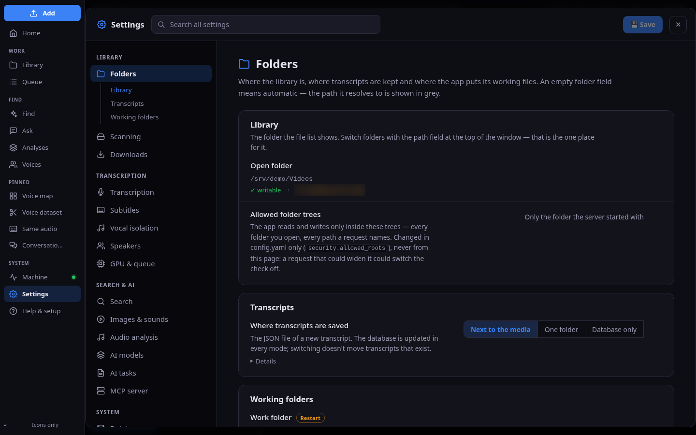<br><sub><b>Settings</b> — every option on 18 searchable pages</sub></td><td width="50%">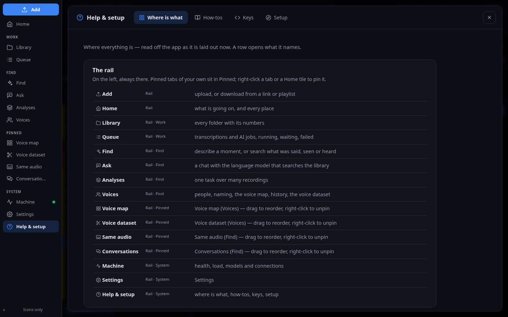<br><sub><b>Help & setup</b> — where everything is, how-tos and the setup guide</sub></td></tr>
</table>

## 📖 Documentation

| | |
|---|---|
| **[The guide](docs/GUIDE.md)** | Installing, every feature, configuration, CLI, database, search, MCP, hardware, limits — with a full table of contents |
| **[Operating](docs/OPERATING.md)** | Updates, backups and restore, running as a service, behind a reverse proxy |
| **[Paths](docs/PATHS.md)** · **[LLM pipeline](docs/LLM-PIPELINE.md)** | Where files live; how the language-model jobs work |
| **[CHANGELOG](CHANGELOG.md)** · **[CONTRIBUTING](CONTRIBUTING.md)** · **[SECURITY](SECURITY.md)** | What changed, how to help, how to report a vulnerability |

**This is a beta (0.9.0).** It has been in daily use for months — but so far by
one person. Until 1.0, a new version may change the configuration, the
database, the HTTP API and the MCP tools; the [CHANGELOG](CHANGELOG.md) will say
so under **Breaking**. Keep your backups. What's still open:
[Known limitations](docs/GUIDE.md#known-limitations). Bug reports and ideas are
very welcome.

**Please use it responsibly.** Transcribing, identifying voices and searching
other people's recordings can need their consent where you live — see
*Responsible use* in the [guide](docs/GUIDE.md#models-and-their-licenses).

## 📜 License

[MIT](LICENSE). The models it downloads come with their own licenses — some are
**non-commercial**: see [Models and their licenses](docs/GUIDE.md#models-and-their-licenses)
and [THIRD_PARTY_NOTICES.md](THIRD_PARTY_NOTICES.md). Built on the shoulders of
WhisperX, pyannote.audio, faster-whisper, audio-separator, llama.cpp and many
more — see the [Acknowledgements](docs/GUIDE.md#acknowledgements).
